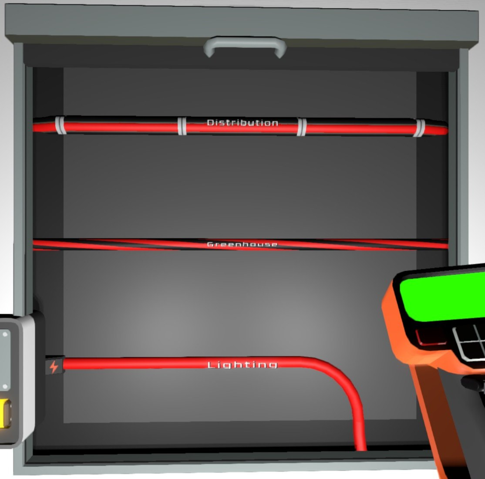

# Cable Labels

A label for cables: the vanilla pipe label, made thinner, for naming a run of cable so you can
tell your circuits apart. Idea by Kastuk.

Cable labels in use.

## Using it

1. **Print a Kit (Cable Label)** at the Electronics Printer, for 1 iron.
2. **Place it on a straight stretch of cable**, as you would a cable fuse: not on a corner,
   junction or broken cable. It fits itself to normal, heavy and super-heavy cable.
3. **Name it with the Labeller.** The name shows on both sides of the label.

The label has open gaps at the top and bottom, like the pipe label. If you look down into one,
roll the label as you place it (**Insert** / **Page Up**) so its text faces you. It comes apart
with the same tool as a pipe label.

## Installing

Subscribe on the
[Steam Workshop](https://steamcommunity.com/sharedfiles/filedetails/?id=3842098701). Cable
Labels is a [StationeersLaunchPad](https://github.com/StationeersLaunchPad/StationeersLaunchPad)
mod and needs BepInEx.

- **In multiplayer, install it on the host and every client.** It adds a new structure.
- **Removing it from a save removes the cable labels placed in it.** Everything else in the save
  is unaffected.

## For mod authors: labels on your cables

**Most mods need nothing.** A label measures the cable it's on and fits itself to it, which
works for any round cable, modded or not. Tell labels how to fit your cables only when that
doesn't work:

- **Your cable's meshes reach further than the cable itself,** say a slack loop coiled on a
  snowshoe. Measuring would size the label to the coil, so give the cable's own radius.
- **Your cable isn't round,** say a pair of bare conductors. Give a label mesh of your own.

You don't reference Cable Labels to do this, and nothing breaks for players without it:

1. Copy [ICableLabelMount.cs](Assets/CableLabels/Contracts/ICableLabelMount.cs) into your mod
   **verbatim**: the same namespace (`CableLabels.Contracts`), name and members, and public.
   Cable Labels recognises your copy by its name.
2. Implement it on your cable class, or on another component on the cable's GameObject:
   - **`CableLabelRadius`**: the radius in metres the label sits at, or `null` to measure.
   - **`TryCreateLabelMesh`**: your label mesh and its position in your cable's frame, or
     `false` for the standard label. It's called once per cable prefab and the result kept, so
     build the mesh there and don't cache it yourself. Return `CancellationToken.None` unless
     the mesh can change; cancelling the token you return makes every label on that prefab
     refit.

   The comments in the file give the details: how to lay out the mesh's UVs for the text, and
   what's ignored when.
3. Check the BepInEx log: it notes each of your cable types it found, or names the member of
   your copy that doesn't match.

A label's hover outline and the area you aim at to rename it follow your mesh. The aiming area
stands out past your cable's own colliders, so the label is picked before the cable.

The interface will never change, so your copy keeps working with every version of Cable Labels.

## Building from source

The repository is a Unity 2022.3.62f3 project. After copying the game's, BepInEx's and
LaunchPad's DLLs into `Assets/Assemblies/`, `.\tools\install.ps1 -Target Local` builds the mod
and installs it into your LaunchPad mods folder. [AGENTS.md](AGENTS.md) has the details and
explains how the mod works inside.

## Licence

[MIT](LICENSE).
